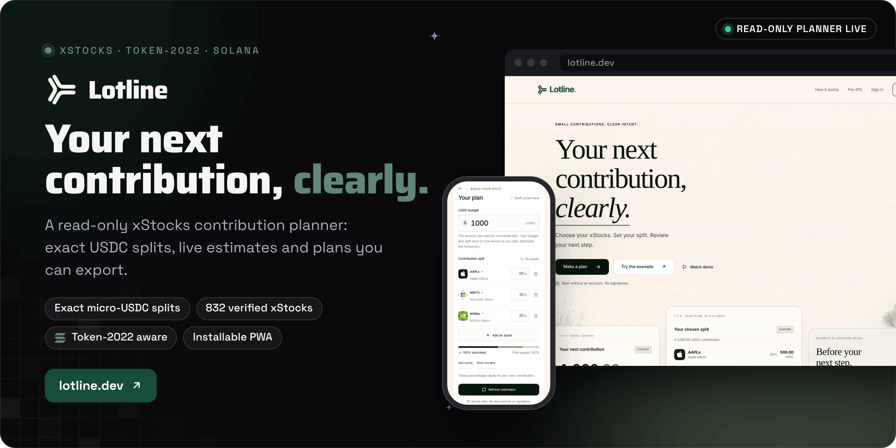
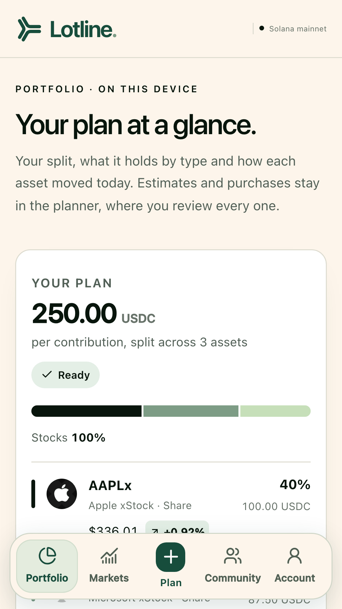
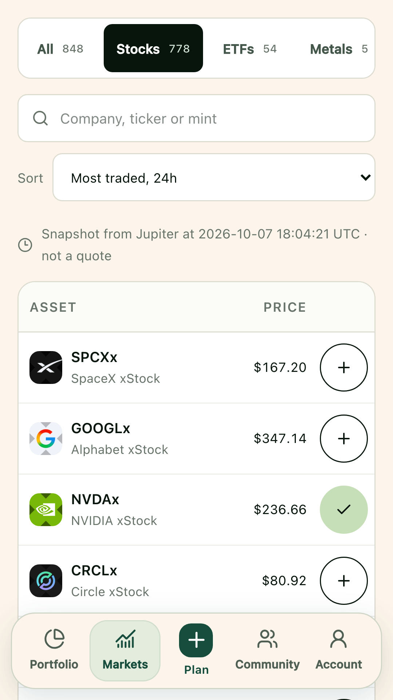
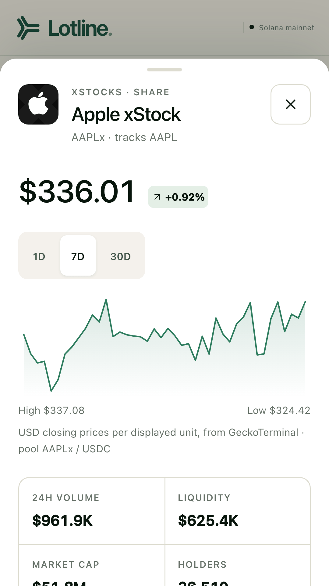

<div align="center">



<br><br>

<a href="https://lotline.dev/app?mode=example"></a>&nbsp;&nbsp;
<a href="https://lotline.dev/app"></a>&nbsp;&nbsp;
<a href="https://lotline.dev/demo"></a>

<br><br>

<a href="https://github.com/operatoruplift/lotline/actions/workflows/ci.yml"></a>
<a href="https://lotline.dev"></a>


<a href="LICENSE"></a>

<h3>Choose your xStocks. Set your split. Review your next step.</h3>

<b>Choose</b> &nbsp;→&nbsp; <b>Split</b> &nbsp;→&nbsp; <b>Estimate</b> &nbsp;→&nbsp; <b>Verify</b> &nbsp;→&nbsp; <b>Share</b> &nbsp;→&nbsp; <b>Review on Jupiter</b>

<br>

<a href="#how-it-works">How it works</a> &nbsp;·&nbsp;
<a href="#ecosystem-integrations">Integrations</a> &nbsp;·&nbsp;
<a href="#status">Status</a> &nbsp;·&nbsp;
<a href="#run-it-locally">Run it locally</a> &nbsp;·&nbsp;
<a href="#documentation">Docs</a>

</div>

<br>

<picture>
  <source media="(prefers-color-scheme: dark)" srcset="docs/readme/screens-dark.png">
  
</picture>

<p align="center"><sub>Captured from a local production build in Example mode on 30 October 2026. Example balances and estimates are synthetic practice values, not prices.</sub></p>

**Lotline plans your next USDC contribution across tokenized stocks on Solana, to the exact micro-unit.** Choose up to ten issuer-verified xStocks, enter a budget and set your percentages. Lotline allocates every micro-USDC, shows the exact mint behind each asset, reads the Token-2022 multiplier that changes what a balance displays, and asks Jupiter for read-only estimates. It is built for someone who already knows their assets and split and wants to repeat a contribution accurately: the percentages apply to the new contribution, not to target weights for an existing portfolio. Purchases happen in your own wallet on Jupiter, which is the boundary this release is built around.

Built by Matt ([RVAClassic](https://x.com/rvaclassic), [Operator Uplift](https://operatoruplift.com)) for the Solana Foundation **Stocklana** sprint, September 2026.

<br>

## How it works

<picture>
  <source media="(prefers-color-scheme: dark)" srcset="docs/readme/flow-dark.png">
  
</picture>

<table>
  <tr valign="top">
    <td width="33%"><b>Exact to the micro-unit</b><br><sub>Budgets are decimal strings with up to six fractional digits, bounded to 1,000,000 USDC. Allocation runs on BigInt micro-units and integer basis points, and leftover micro-units go to the largest remainders, with basket order breaking ties.</sub></td>
    <td width="33%"><b>Units the token really holds</b><br><sub>Token accounts are summed by owner and mint. Token-2022 Scaled UI Amount conversion uses the official helper and chain time, and raw holdings plus quoted output are converted together, never added as rounded strings.</sub></td>
    <td width="33%"><b>Estimates that expire</b><br><sub>A Jupiter estimate lasts at most 30 seconds. Copies and CSVs keep the original quote time with an explicit fresh, stale or unavailable state, and exporting never refreshes a quote.</sub></td>
  </tr>
</table>

**Example and Live.** Example mode needs no credentials: it carries all 832 reviewed identities from the bundled snapshot with synthetic balances and estimates. The six original walkthrough assets keep their synthetic rates and non-unit scaling examples; the other 826 use zero illustrative holdings and a deliberately generic one unit per 100 USDC. Live mode verifies issuer data and the mainnet mint, optionally reads a public wallet's balances, and requests amount-specific estimates in batches of three. Missing configuration or a failed upstream call produces an explicit unavailable state, and Live never substitutes Example values.

<details>
<summary><b>Using the planner</b></summary>
<br>

The pinned issuer snapshot holds **832 Solana stocks and ETFs**, verified on 12 September 2026 at 09:35 UTC. Search by company or ticker, with official logos and reviewed mint identities. This dated catalog count is not a claim of current liquidity; see [catalog provenance and refresh instructions](docs/xstocks-catalog.md).

1. Select one to ten assets, set percentages totaling exactly 100%, and enter a budget.
2. Optionally load a public wallet's selected-token and USDC balances. A wallet extension is not required, and addresses are not stored in browser storage or saved cloud plans.
3. Choose **Get estimates**. The results show the exact USDC allocation, estimated received units, and estimated resulting units when balances are available. Every estimate keeps its original timestamp.
4. Copy the plan or download its CSV. To review a trade independently, open the official Jupiter swap page with the selected mint and exact USDC amount prefilled. Example never signs or submits.
5. Return to the saved device draft, change the contribution amount and request new estimates. Optionally sign in and choose **Save this plan** to keep a named plan across devices. Signing in alone does not upload the draft.

**Split evenly** gives a deterministic equal distribution, you can replace an asset without rebuilding the basket, and **Copy plan link** shares the mode, budget, verified-mint choices and percentages in a URL fragment. The recipient reviews it in a dialog before applying it; wallet addresses, balances, quotes and account data never enter the link.

The external link opens the official `https://jup.ag/swap/` route with the selected mint and exact amount prefilled. Lotline cannot observe or confirm a purchase there, and a later holdings reload is a fresh wallet read, not evidence of a specific trade.

For a quick precision check, set **10.000001 USDC** at **50/30/20**. The exact allocations are **5.000001 / 3.000000 / 2.000000 USDC**. **Verify this plan** exposes the arithmetic, issuer and mint sources, and quote freshness. A device draft is editable input, a named cloud plan is an explicitly saved copy, and an estimate expires and must be requested again.

</details>

<details>
<summary><b>Precision and freshness, in full</b></summary>
<br>

- Budgets use plain decimal strings with up to six fractional digits, bounded to 1,000,000 USDC. Allocation uses BigInt micro-units and integer basis points, then distributes leftover micro-units by largest remainder with stable basket-order ties.
- Token accounts are enumerated by owner and mint, and all valid raw amounts are summed. Confirmed zero and unavailable holdings are distinct.
- Token-2022 Scaled UI Amount conversion uses the installed official helper and chain time. Resulting units convert `holdingsRaw + quoteOutRaw`; rounded UI strings are never added. Unsupported scaling is labeled unavailable.
- Estimates expire after at most 30 seconds, sooner when the provider supplies an earlier expiry. Cached estimates keep their retrieval time. Plan edits invalidate results, and obsolete requests cannot overwrite the edited plan.
- Copied plans and CSVs preserve original quote times and include the effective expiry, source, export time and an explicit fresh, stale or unavailable state. Exporting never refreshes a quote.
- Issuer halt status suspends estimates for that asset. It is not a claim about DEX market hours or liquidity.
- Estimates are not guaranteed, and future network costs can be omitted from quote-only responses. **Review current amounts and fees on Jupiter.** Insufficient current USDC is informational and does not prevent planning a future contribution.

</details>

<p align="center"><sub>Next.js 16 · React 19 · TypeScript · Tailwind CSS 4 · @solana/kit 8 · Token-2022 helpers · Jupiter · Supabase · Zod · Lucide · Vitest · Playwright · PWA · Android Web Shell</sub></p>

<br>

## Ecosystem integrations

Four Solana data sources sit beside the planner. Each one reads, labels what it read and when, and never routes a purchase.

<table>
  <tr>
    <th width="17%" align="left">Source</th>
    <th width="48%" align="left">What Lotline shows</th>
    <th width="35%" align="left">Boundary</th>
  </tr>
  <tr valign="top">
    <td><b>PreStocks</b></td>
    <td>A separate <a href="https://lotline.dev/pre-ipo">planner</a> for eight pre-IPO assets (Anduril, Anthropic, Figure AI, Kalshi, Neuralink, OpenAI, Polymarket and SpaceX), each re-confirmed against the PreStocks API and verified on mainnet as a Token-2022 mint with Scaled UI Amount.</td>
    <td>Read-only Jupiter estimates, local drafts and share/export. PreStocks purchases are not enabled.</td>
  </tr>
  <tr valign="top">
    <td><b>Pyth</b></td>
    <td>Equity, token and USDC/USD references for AAPLx, MSFTx and NVDAx, read keyless from Pyth Lazer and cross-checked against Pyth's receiver accounts on Solana mainnet.</td>
    <td>Context beside an estimate. A reference never replaces or extends a Jupiter quote.</td>
  </tr>
  <tr valign="top">
    <td><b>Backpack</b></td>
    <td>The venue's last trade for companies that are also in your plan (MU, SNDK, SPCX and SKHY on 27 September 2026), with the difference in basis points and that day's trade count.</td>
    <td>A comparison of different tokens for one company, not a route. Lotline never opens a Backpack account.</td>
  </tr>
  <tr valign="top">
    <td><b>Meteora DBC</b></td>
    <td>Launch pools that quote in a selected xStock, with curve progress, reserves and the exact fee, computed with the official SDK's pure quote function at one confirmed slot.</td>
    <td>Never creates a pool, signs or buys through a bonding curve.</td>
  </tr>
</table>

<details>
<summary><b>How each integration is checked</b></summary>
<br>

**PreStocks: pre-IPO identity and estimates.** The eight identities are pinned in `lib/domain/prestocks.ts`. Every catalog load re-confirms each one against the live PreStocks API (name, contract address, image and issuer link) before the asset is offered. Each mint is then verified on Solana mainnet as a Token-2022 mint with the Scaled UI Amount extension, and re-read immediately before every quote, so a paused mint or a changed metadata pointer stops the estimate rather than silently pricing a different token. Estimates come from the same read-only Jupiter order endpoint the xStocks planner uses, with no taker and nothing signed. Adding a newly listed PreStocks asset means editing the pinned list and re-running the mainnet verification, which is why the registry is a deliberate allowlist. Server routes are under `app/api/prestocks/`. Transfer-fee and confidential token balances stay unavailable where their account semantics are unsupported. See the [sponsor release evidence](docs/sponsor-release-20260921.md).

**Pyth: price context for an estimate.** For AAPLx, MSFTx and NVDAx, Lotline reads the pinned equity and token feeds plus USDC/USD and shows them beside the Jupiter estimate. No key is needed: the server asks Pyth Lazer's proxy for the seven pinned feeds by their Lazer ids and validates every answer before exposing a price. Each returned id must be one it asked for, no id may repeat, confidence must sit below the price, and a publish time in the future rejects the whole batch. Every equity reading carries Pyth's own market-session flag, so outside trading hours the panel labels the print "last close, market closed", and the purchase-review gate stays closed until the session reopens and both feeds are fresh again.

Each equity and USDC reading is cross-checked against the `PriceUpdateV2` receiver accounts that Pyth's push oracle keeps on Solana mainnet. The server derives each account from the push-oracle program, the shard and the feed id (shard 1 carries the US equities live during a session, shard 0 carries USDC/USD), requires the receiver program as owner, the account discriminator, a full verification tag and a matching feed id, and withholds any leg where two fresh readings disagree by more than 100 basis points. If Lazer cannot be reached, the on-chain readings stand alone and the token legs are absent rather than invented. Freshness is always measured from Pyth's own publish time. With `PYTH_API_KEY` set, Hermes becomes the primary source and the same on-chain cross-check applies to USDC/USD. `scripts/verify-pyth-feeds.mjs` checks feed identities against Pyth's official MCP server and the Lazer symbol registry; all seven pinned feeds matched on both on 27 September 2026. Code: `lib/server/pyth.ts`, `lib/server/pyth-lazer.ts`, `lib/server/pyth-onchain.ts`.

**Backpack: the venue price for the same company.** Backpack Securities tokenizes a small set of US stocks itself and publishes a keyless venue tape. Where one of those companies is also an xStock in your plan, Lotline reads the venue's last trade through its own route, `POST /api/rails`, and shows it beside what the Jupiter estimate pays per unit, so a thin tape is labelled as thin. Trading on Backpack needs a Backpack account, which Lotline never opens, signs into or funds. Code: `lib/domain/rails.ts`, `lib/server/backpack.ts`, `components/rail-comparison.tsx`.

**Meteora: where your asset prices other tokens.** Meteora's Dynamic Bonding Curve program lists tokenized stocks as **quote** tokens rather than as assets for sale: an xStock that holds a DBC token badge can price newly created tokens in launch pools. For a selected asset, Lotline checks the token badge account, finds the curve configs that quote in the asset, opens their pools, and computes an estimate with the official SDK's pure quote function at one confirmed slot, reporting curve progress against the migration threshold, reserves and the fee the curve charged. Each figure is labelled with the pool it came from and the slot it was read at. It is not a way to buy an xStock (a USDC to xStock route runs through Jupiter) and it is not a write path. PreStocks tokens carry no DBC badge. Code: `lib/domain/dbc.ts`, `lib/server/meteora-dbc.ts`, `components/dbc-pairs.tsx`.

Optional **Load asset context** uses Tokens.xyz through a server adapter on a deployment with approved API access. Eligibility, allocation, balances, unit conversion and quote freshness never depend on it; see [contract and activation requirements](docs/tokens-enrichment.md).

</details>

<br>

## Markets, Portfolio and community plans

These ship behind operator flags. With every flag unset, the planner, header and routes are unchanged and the flagged routes answer 404; CI proves both states with two browser suites.

<table>
  <tr valign="top">
    <td width="33%" align="center"><br><sub><b>Portfolio</b>: each saved plan's split, mix by type and daily moves, read from this browser</sub></td>
    <td width="33%" align="center"><br><sub><b>Markets</b>: every verified asset with a dated Jupiter snapshot, never a quote</sub></td>
    <td width="33%" align="center"><br><sub><b>Asset sheet</b>: price history, liquidity and the verified identity</sub></td>
  </tr>
</table>

<p align="center"><sub>From the repository's dApp Store listing kit in <a href="docs/dapp-store/listing.md">docs/dapp-store</a>, which <code>scripts/generate-store-kit.mjs</code> captures from lotline.dev. The Markets snapshot in these screens is dated 7 October 2026.</sub></p>

| Flag | What it adds |
|---|---|
| `LOTLINE_MARKETS_ENABLED=true` | **Markets** (`/markets`): all 840 verified assets (stocks, ETFs with metals, bonds and leveraged ETFs called out, and pre-IPO tokens) with a dated Jupiter snapshot, a per-asset sheet with a 1D/7D/30D chart, one-tap adding to the device draft and a reviewed `/app?add=<mint>` link. **Portfolio** (`/portfolio`), the phone-first home. The phone tab bar, and **Balance toward your split**, which suggests a no-sell division of the next contribution from loaded balances. See [markets](docs/markets.md) and [portfolio](docs/portfolio.md). |
| `LOTLINE_GALLERY_ENABLED=true` | **Community plans**: members share a saved plan's name and split (never its budget), anyone can copy one into the planner's review dialog with their own budget, and plans rank by copies, never by returns. See [community plans](docs/community-plans.md) and [moderation](docs/community-moderation.md). |
| `LOTLINE_CRYPTO_ENABLED=true` | **Crypto** in Markets and the stock planner: SOL, bitcoin (cbBTC, WBTC), ether and four staked-SOL tokens, each pinned and re-verified on-chain. Buying in Lotline stays stocks-only. See [crypto](docs/crypto.md). |
| `LOTLINE_WALLET_SIGN_IN_ENABLED=true` | **Sign in with Solana**: one signed message, never a transaction, and the first signature creates the account without an email. Needs the Web3 (Solana) provider in Supabase Auth first. See [wallet sign-in](docs/wallet-sign-in.md). |

<br>

## Status

<table>
  <tr valign="top">
    <td width="16%" align="center"></td>
    <td>The read-only planner at <a href="https://lotline.dev">lotline.dev</a>: xStocks planner and Example, PreStocks planner, Pyth references, demo films, brand kit and installable PWA. The latest hosted checks and deployment are recorded in the 1 October 2026 release.</td>
    <td width="22%"><a href="docs/releases/2026-10-01/release.md">1 October release</a></td>
  </tr>
  <tr valign="top">
    <td align="center"></td>
    <td>Markets, Portfolio, community plans, crypto and wallet sign-in, each behind its own operator flag. A read-only check on 30 September 2026 found Markets, Portfolio and community plans enabled on lotline.dev.</td>
    <td><a href="docs/markets.md">Markets and flags</a></td>
  </tr>
  <tr valign="top">
    <td align="center"></td>
    <td>In-app purchases through Wallet Standard and a validated Jupiter and Raydium route, with a durable journal and reconciliation; an operator can also let up to three legs be approved in one wallet prompt. A real unsigned mainnet order passed validation and simulation on 20 September 2026. As of the 1 October 2026 audit purchases remain disabled, no transaction has been signed or submitted, and mainnet settlement is not proven.</td>
    <td><a href="docs/execution.md">Execution readiness</a></td>
  </tr>
  <tr valign="top">
    <td align="center"></td>
    <td>The Seeker Android shell (<code>dev.lotline.app</code>, wrapping lotline.dev with Mobile Wallet Adapter) and the dApp Store listing kit. The shell was lint, type and build checked; the on-device steps still need a phone, and the repository records no store release yet.</td>
    <td><a href="docs/seeker-and-pwa.md">Seeker and PWA</a></td>
  </tr>
  <tr valign="top">
    <td align="center"></td>
    <td>Built for the Solana Foundation Stocklana sprint, September 2026. The official deadline and judging instructions were rechecked on 12 September; a submission draft is ready for team details and review, and the repository records no event submission.</td>
    <td><a href="docs/stocklana-submission.md">Submission draft</a></td>
  </tr>
</table>

Public signup and password recovery stay gated until custom SMTP delivery is verified (`NEXT_PUBLIC_AUTH_EMAIL_ENABLED=false`); existing users can sign in and keep owner-scoped cloud plans. Nothing here claims traction or audits that have not happened.

<br>

## Run it locally

<table>
  <tr valign="top">
    <td width="33%"><b>Prerequisites</b><br><sub>Node.js 22 or newer (builds have been exercised with Node 22.19 and Node 24) and npm 11, which CI pins: with npm 10, <code>npm ci</code> stops with <code>Missing: utf-8-validate@5.0.10 from lock file</code>.</sub></td>
    <td width="33%"><b>Read first</b><br><sub><a href="docs/accounts.md">Accounts and cloud plans</a> before switching on sign-in, and <a href="docs/execution.md">execution readiness</a> before any purchase path.</sub></td>
    <td width="33%"><b>What the checks prove</b><br><sub>Fixture tests are not live-provider evidence. The <a href="docs/integration-verification.md">integration history</a> and <a href="docs/deployment.md">deployment record</a> say what was observed live, and when.</sub></td>
  </tr>
</table>

### 1. Run the app with no credentials

```bash
npm install -g npm@11              # the npm major CI uses for this lockfile
npm ci
SUPABASE_SECRET_KEY='' LOTLINE_SHARED_LIMITS=false VERCEL=0 npm run dev -- --port 3111
```

Open [127.0.0.1:3111](http://127.0.0.1:3111) and choose **Try the example** for the complete experience. Example values are practice values, never live prices, routes, balances or halt checks.

### 2. Before a pull request, run what [CI](.github/workflows/ci.yml) runs

```bash
npm run lint
npm run typecheck                  # generates Next.js route types first, so it works from a clean checkout
npm test                           # Vitest, including database suites on an in-memory Postgres
npm run build
npx playwright install chromium
npm run test:e2e                   # starts a dev server on port 3100 unless E2E_BASE_URL is set
npm run test:e2e:markets           # a production server on 3102 with every operator flag on (build first)
```

`npm run verify` runs the first four in order. Browser checks cover planning, exports, reload persistence, keyboard use, responsive sizes, account-switch isolation, reduced motion, video playback and glass refraction. `supabase/tests/plans_rls.sql` checks database isolation with synthetic fixtures inside a rolled-back transaction. The PWA suite needs a production server: `npm run build`, then `npm run start -- --hostname 127.0.0.1 --port 3101` and `E2E_BASE_URL=http://127.0.0.1:3101 npx playwright test tests/e2e/pwa.spec.ts`.

### 3. Live mode, accounts and operator features

Create `.env.local` from the template only if you do not already have one, fill in what you need, and start the same dev command:

```bash
cp -n .env.example .env.local
```

| Variable | Visibility | Purpose |
|---|---|---|
| `SOLANA_RPC_URL` | Server only | Live mint validation, wallet balances and scaled units. The example supplies public mainnet RPC; a dedicated provider is preferable for shared use. |
| `JUPITER_API_KEY` | Server only | Optional while documented keyless access remains supported. |
| `PYTH_API_KEY`, `PYTH_HERMES_URL`, `PYTH_LAZER_URL` | Server only, optional | Not needed: references are read keyless from Pyth Lazer. With a key, Hermes becomes the primary source. The URL overrides are https origins (routes are appended); a keyless request is only sent to an explicit Hermes override, and no credential is ever sent to Lazer. |
| `NEXT_PUBLIC_SUPABASE_URL`, `NEXT_PUBLIC_SUPABASE_PUBLISHABLE_KEY` | Public, build time | Hosted Supabase project and current `sb_publishable_` key for optional accounts and owner-scoped cloud plans. |
| `NEXT_PUBLIC_AUTH_EMAIL_ENABLED` | Public, build time | The exact string `true` only after testing custom SMTP signup and recovery delivery. The launch deployment uses `false`; existing users can still sign in. |
| `NEXT_PUBLIC_SUPABASE_CAPTCHA_SITE_KEY` | Public, build time | Cloudflare Turnstile site key: every sign-in, sign-up, recovery and wallet grant then carries a CAPTCHA token. Deploy it before enabling captcha in Supabase; see [accounts](docs/accounts.md#captcha-cloudflare-turnstile). |
| `NEXT_PUBLIC_SUPPORT_EMAIL` | Public | Support address on the privacy and terms pages; GitHub Issues is used until it is set. |
| `SUPABASE_SECRET_KEY` | Server only | Current `sb_secret_` key; required on Vercel for shared provider coordination, the shared rate buckets, guest reports, account deletion and the retention cron. Sign-in and cloud plans use the member's own session, and the key never reaches the browser. |
| `LOTLINE_IP_HASH_SALT` | Server only | Keys the salted hashes of connection addresses (at least 32 random characters). Until it is set, `SUPABASE_SECRET_KEY` keys them. |
| `CRON_SECRET` | Server only | Bearer token Vercel sends to the daily retention cron in `vercel.json`; the route answers 503 until it is set. See [scheduled retention](docs/deployment.md#scheduled-retention). |
| `LOTLINE_SHARED_LIMITS` | Server only | `true` requires the shared limiter locally. Vercel requires it automatically. |
| `LOTLINE_MARKETS_ENABLED`, `LOTLINE_GALLERY_ENABLED`, `LOTLINE_CRYPTO_ENABLED`, `LOTLINE_WALLET_SIGN_IN_ENABLED` | Server only | The operator flags in [Markets, Portfolio and community plans](#markets-portfolio-and-community-plans). Apply each feature's migration first. |
| `LOTLINE_EXECUTION_ENABLED` and the other `LOTLINE_EXECUTION_*` variables | Server only | Safety gates for a deployment that runs the in-app order path: migration readiness flags, the repository, the acknowledged validator version, the keyless-Jupiter opt-in, the batch migration, the access policy and the reviewed wallet allowlist. Every one is documented in `.env.example`; see [execution readiness](docs/execution.md). |
| `TOKENS_XYZ_ENABLED`, `TOKENS_XYZ_API_KEY` | Server only | Optional exact-mint context, enabled with the exact flag `true` on a deployment with approved `assets:read` access. See [Tokens.xyz requirements](docs/tokens-enrichment.md). |

Never put a privileged key or a credential-bearing RPC URL in a public variable. `.env.local` is ignored by Git. Public RPC and Jupiter endpoints may throttle requests.

<details>
<summary><b>Deploy your own (Supabase and Vercel)</b></summary>
<br>

The September 11 to 12 deployment records describe a configured Supabase project, a Git-connected Vercel project and the migrations applied at those checkpoints; those historical records alone do not establish the latest release or revalidate its credentials. The [deployment record](docs/deployment.md) separates the current release from historical observations.

For a separate deployment:

1. In an authorized Supabase project, apply the migrations in `supabase/migrations/` in timestamp order; with the Supabase CLI, link the project and run `supabase db push`. The guest-execution migrations (`20260915090000_guest_execution_owner_index.sql`, then `20260919090000_execution_integrity.sql` for per-run attempt locking and receipt retention) only matter if guest execution is intended: set `LOTLINE_EXECUTION_GUEST_MIGRATIONS_READY=true` only after their quota, retention and rate-limit functions are checked.
2. Enable email/password authentication with confirmation and a minimum password length of 12. Set the correct site origin and allow its `/auth/callback` and `/auth/callback?next=/auth/update-password` redirects. Preserve existing settings when sharing a project.
3. Configure a custom SMTP sender for public signup and password-reset delivery. Supabase's default SMTP is restricted, and unrestricted delivery has not been established for this launch. Only after a real confirmation and recovery delivery test should you set `NEXT_PUBLIC_AUTH_EMAIL_ENABLED=true` and rebuild.
4. Import the repository into Vercel with the Next.js preset and Node 22 or newer. Set the variables above in every intended environment before building; public Supabase values must exist at build time.
5. Deploy, then check Example, Live data, sign-in, saved-plan isolation and production PWA behavior using that deployment's actual configuration.

A static export is not supported because Live and account features need server routes. A self-hosted Node deployment can use `npm ci`, `npm run build` and `npm run start`; multiple instances should enable shared provider coordination.

</details>

<details>
<summary><b>Storage, services and request limits</b></summary>
<br>

Guest basket settings, budget and the manual review cadence are saved in versioned localStorage on the current browser and device, with safe recovery from corrupt values. Supabase handles optional email/password authentication (and, with its flag, Sign in with Solana) and session cookies. An explicit cloud save stores a plan name, verified mints, basis-point weights and the exact budget under the signed-in owner; wallet addresses, balances, quotes and projections are excluded. The database enforces owner access with forced row-level security, validates plan content and limits each account to 20 plans. Members can load or delete saved plans and delete their whole account from the app. See [accounts](docs/accounts.md), the [privacy policy](https://lotline.dev/privacy) and the [terms](https://lotline.dev/terms).

Live provider requests use narrow same-origin handlers. Server adapters validate issuer, Solana RPC and Jupiter responses and expose normalized fields; RPC URLs, API keys and raw provider errors are never returned. Catalog caching is about one hour, holdings about 15 seconds, and identical quotes only briefly within freshness. Requests have timeouts, queue bounds and a user-driven retry path.

The Supabase-backed limiter reserves upstream start times across Vercel instances: Jupiter requests are spaced by at least 2.1 seconds and Solana requests by 150 milliseconds. Its bounded backlog rejects excess work instead of growing, and its table holds provider timing only, with no wallet or account data. A single local process also uses bounded in-process queues. Other applications using the same upstream key or IP can still consume provider allowances.

</details>

<details>
<summary><b>Install, offline use and the Seeker</b></summary>
<br>

Lotline is a responsive, installable Progressive Web App: supported browsers can add it to the home screen, dock or desktop with a standalone window. After the app reports **Example is ready to use offline**, disconnected public-page navigation opens the synthetic Example planner, where exact allocation, local drafts, Example estimates and CSV export keep working. Live data, authentication and cloud plans need connectivity, and API responses, account pages, authentication flows and private plans are never cached. See [installation and offline behavior](docs/pwa.md).

For the Solana Seeker and the Solana dApp Store, an Android WebView shell in `android/` opens the same site with Solana Mobile Wallet Adapter support where the app connects a wallet. It is not on the App Store or Google Play. Build, signing, test and publishing steps are in [Seeker and PWA readiness](docs/seeker-and-pwa.md), and every Publisher Portal field is in the [store listing kit](docs/dapp-store/listing.md).

</details>

<details>
<summary><b>Dependency review</b></summary>
<br>

Meteora's official SDK is the source of the bonding-curve quote, and it is built on the older Solana JavaScript stack, so it adds Anchor and spl-token alongside Lotline's own `@solana/kit`. That chain carries high-severity advisories with no patched release in it. The production build was checked: none of the affected packages appears in the compiled output of the route that uses the SDK, which calls only the program IDL and a pure quote function, and every account decoded is fetched by address and checked for program ownership and length first. The analysis and the commands to re-check it are in the [dependency review](docs/dependency-review-20260926.md).

</details>

<details>
<summary><b>Repository layout</b></summary>
<br>

| Path | Contents |
|---|---|
| `app/` | Website, planner, PreStocks planner, Markets, Portfolio, demo, authentication, privacy and terms, offline page and narrow API routes |
| `components/` | Responsive planner, account controls, installation UI and shared visual components |
| `lib/domain/` | Pure exact math, plan identity, bounded share-link encoding, storage schema, text and CSV exports, the pinned registries |
| `lib/server/` | Verified catalog, read-only Solana data, quote-only Jupiter adapter, Pyth, Backpack and Meteora readers, shared provider limits |
| `lib/server/execution/` | The opt-in Jupiter order boundary, exact signed-message and receipt checks, a narrow Jupiter route_v2 and Raydium CLMM semantic validator, and the Supabase journal adapter |
| `lib/supabase/` | Public, browser and server clients plus cloud-plan validation |
| `lib/demo/` | Visibly synthetic Example fixtures |
| `supabase/` | Versioned migrations, Auth configuration and database isolation checks |
| `public/` | Service worker, Lotline logo assets, downloadable brand kit, bundled official xStocks logos, films and PWA icons |
| `android/` | The Seeker Web Shell project |
| `scripts/` | Brand, store-kit and media generation, release recording, catalog refresh and classification, and Pyth feed verification |
| `tests/` | Domain, service and database suites, plus the two Playwright browser suites |
| `docs/` | Dated evidence, screenshots, setup details, product descriptions, design direction and video materials |

</details>

<br>

## Documentation

<table>
  <tr valign="top">
    <td width="33%"><b>Understand it</b><br><sub><a href="docs/product-description.md">Short and full descriptions</a><br><a href="docs/xstocks-catalog.md">Verified xStocks catalog</a><br><a href="docs/accounts.md">Accounts and cloud plans</a><br><a href="docs/execution.md">Execution readiness</a></sub></td>
    <td width="33%"><b>Use the features</b><br><sub><a href="docs/markets.md">Markets</a> and <a href="docs/portfolio.md">Portfolio</a><br><a href="docs/community-plans.md">Community plans</a> and <a href="docs/community-moderation.md">moderation</a><br><a href="docs/crypto.md">Crypto</a> and <a href="docs/wallet-sign-in.md">wallet sign-in</a><br><a href="docs/pwa.md">Install Lotline</a></sub></td>
    <td width="33%"><b>Check it</b><br><sub><a href="docs/deployment.md">Deployment status and history</a><br><a href="docs/releases/2026-10-01/release.md">Launch film and mainnet readiness, 1 October 2026</a><br><a href="docs/contribution-release-20260920.md">Contribution release, 20 September 2026</a><br><a href="docs/integration-verification.md">Integration history</a></sub></td>
  </tr>
  <tr valign="top">
    <td><b>Show it</b><br><sub><a href="docs/video-release.md">Films, narration, captions and transcripts</a><br><a href="docs/stocklana-demo-script.md">115-second demo script</a><br><a href="docs/brand.md">Brand identity</a> and <a href="https://lotline.dev/brand-kit">downloadable brand kit</a><br><a href="docs/design-direction.md">Design direction</a> and <a href="docs/design-media.md">media provenance</a></sub></td>
    <td><b>Ship it</b><br><sub><a href="docs/seeker-and-pwa.md">Seeker, Android and PWA</a><br><a href="docs/dapp-store/listing.md">dApp Store listing kit</a><br><a href="docs/dependency-review-20260926.md">Dependency review</a><br><a href="docs/tokens-enrichment.md">Tokens.xyz context</a></sub></td>
    <td><b>Submit it</b><br><sub><a href="docs/stocklana-submission.md">Stocklana submission draft</a><br><a href="docs/stocklana-check.md">Dated requirements recheck</a><br><a href="docs/usability-test-guide.md">Human usability-test guide</a><br><a href="docs/finish-report-20260919.md">19 September continuation</a> (historical)</sub></td>
  </tr>
</table>

<br>

<p align="center"><sub>Lotline application code is MIT licensed (see <a href="LICENSE">LICENSE</a>); third-party libraries keep their own licenses. Issuer logos identify xStocks and PreStocks, with attribution in the <a href="docs/xstocks-catalog.md">catalog record</a> and <a href="docs/releases/2026-09-21/prestocks-integration.md">PreStocks record</a>. Decorative media and the Higgsfield narration are documented in the <a href="docs/design-media-manifest.json">media manifest</a> and <a href="docs/video-release.md">video release</a>; provenance is not a blanket redistribution license, so keep provider attribution and rights when reusing those assets.</sub></p>

<p align="center"><sub>Built by <a href="https://rvaclassic.xyz">Matt Sim</a>, founder of <a href="https://operatoruplift.com">Operator Uplift</a>. More builds at <a href="https://github.com/operatoruplift">github.com/operatoruplift</a>. Want one built for your product? <a href="https://cal.com/rvaclassic/15min">Book a 15-minute call</a>.</sub></p>
